# E-Rally Autonomous Track (EVER 2024)

<p align="center">
  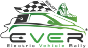
</p>

This is the autonomous-driving software that team **E-Rally** from **Helwan University** built for the **autonomous track** of **EVER 2024 (Electric Vehicle Rally)** in Egypt, a competition where universities compete. A simulated electric car drives four tracks (linear, lane change, circular and custom) using a YOLO detector, a single-camera distance estimate, a Kalman-filtered odometry and PID controllers. Everything runs as ROS 1 nodes against a CoppeliaSim scene.

I was part of the autonomous track sub-team. This repository presents the project from my side with the code, system design, test results and the Milestone 3 report.

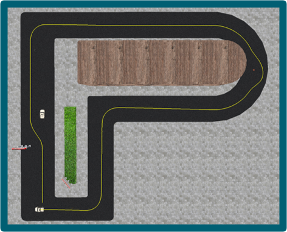

## Achievements

- Represented Helwan University (team **E-Rally**) in the EVER 2024 autonomous track
- Built the full stack: perception, distance estimation, state estimation and control
- Trained two YOLO models, one for the basic tracks and one 7-class model for the custom track
- Completed four tracks in simulation, from a straight road to a custom track with corners, cars, cones and pedestrians

## Project at a glance

| Item | Detail |
|---|---|
| Competition | EVER 2024, Electric Vehicle Rally, Egypt (autonomous track) |
| Team | E-Rally, Helwan University |
| Simulator | CoppeliaSim EDU |
| Middleware | ROS 1 (`rospy`) |
| Perception | YOLO (Ultralytics, PyTorch), `cv_bridge`, detections kept above 0.7 confidence |
| Distance estimation | Linear calibration from bounding-box height and known object height |
| State estimation | Kalman filter on odometry position and orientation |
| Control | PID for path distance, pedestrian distance and steering angle |
| Analysis | MATLAB telemetry plots |

## System architecture

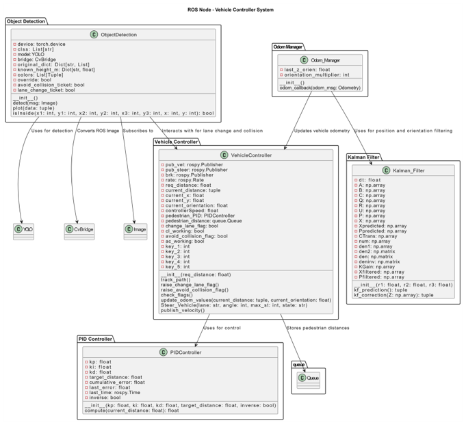

| Component | Role |
|---|---|
| `ObjectDetection` | Subscribes to the camera image, runs YOLO, estimates distance, and raises the lane-change and collision-avoidance flags |
| `Odom_Manager` | Receives raw odometry, filters it, and unwraps the heading angle |
| `Kalman_Filter` | Smooths position and orientation |
| `VehicleController` | Follows the track, applies the flags, and publishes velocity, steering and brake |
| `PIDController` | Used for path distance, pedestrian distance and steering angle |

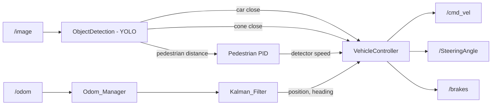

### ROS interface

| Topic | Type | Direction |
|---|---|---|
| `/image` | `sensor_msgs/Image` | Subscribed by the detector |
| `/odom` | `nav_msgs/Odometry` | Subscribed by the odometry manager |
| `/cmd_vel` | `std_msgs/Float64` | Published speed command |
| `/SteeringAngle` | `std_msgs/Float64` | Published steering angle |
| `/brakes` | `std_msgs/Float64` | Published brake command |

The node runs on top of the ROS 1 stack: the application layer, the client library with TCP/UDP ROS, and Linux.

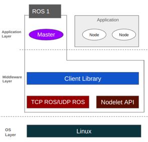

## How it works

### 1. Detection and the lane region

The detector converts each ROS image with `cv_bridge`, runs YOLO, and keeps detections above 0.7 confidence. On the linear, lane change and circular tracks the model is `CPC_model.pt` (car, cone, pedestrian). The custom track uses `custom_c7_model.pt`, which has 7 classes and was trained further for the more dynamic scene.

To decide whether an object matters, the code checks whether the bottom corner of its bounding box falls inside a triangle in front of the car (the red area below, with corners at pixels (480, 240), (45, 480) and (915, 480)). Only objects inside it get a distance estimate.

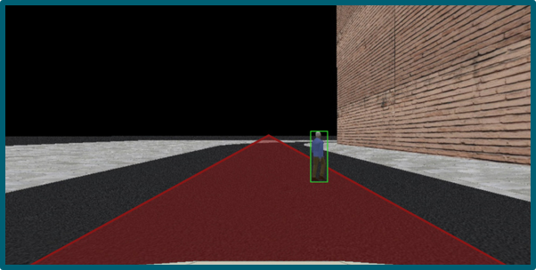

### 2. Dataset for the custom track

The 7-class model was trained on **384 images** with **1,513 annotations** (3.9 per image, 0 missing annotations).

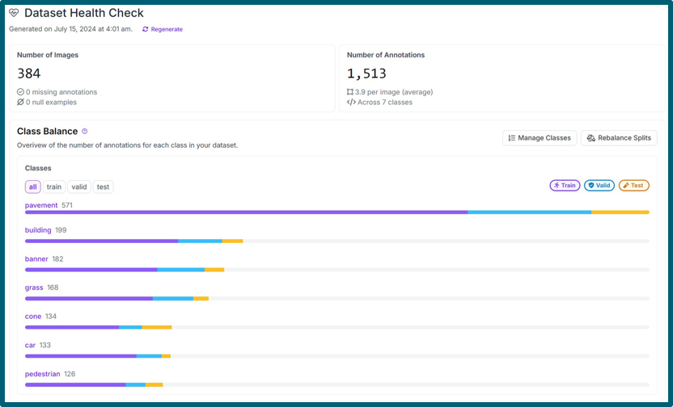

| Class | Annotations |
|---|---|
| pavement | 571 |
| building | 199 |
| banner | 182 |
| grass | 168 |
| cone | 134 |
| car | 133 |
| pedestrian | 126 |

Only cars, cones and pedestrians drive decisions. The other classes help the model separate the road from its surroundings.

### 3. Distance from one camera

The distance comes from the height of the bounding box in pixels and a known real height per class (car 1.55 m, cone 0.66 m, pedestrian 1.65 m). The camera was calibrated in simulation with a 1 m object:

| Distance | Object height on screen |
|---|---|
| 5 m | 105 px |
| 10 m | 52.5 px |

A line through those two points gives `y = (-10.5 x + 157.5) * k`, where `y` is the pixel height, `x` the distance and `k` the real object height. Solving for the distance gives the formula used in the code:

```
distance = max( ((h / k) - 157.5) / -10.5 , 0 )
```

with `h` the bounding-box height in pixels. The calibration scene below shows the same relationship: a 1 m cube at 5 m and a 2 m cube at 10 m both measure 105 px.

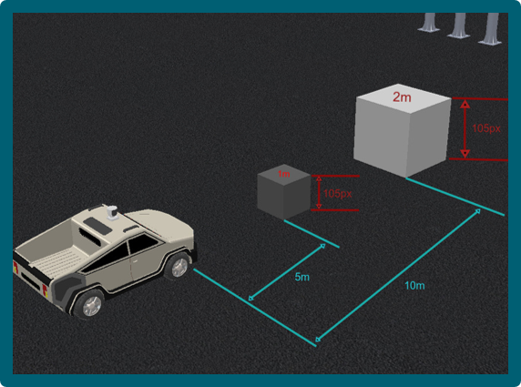

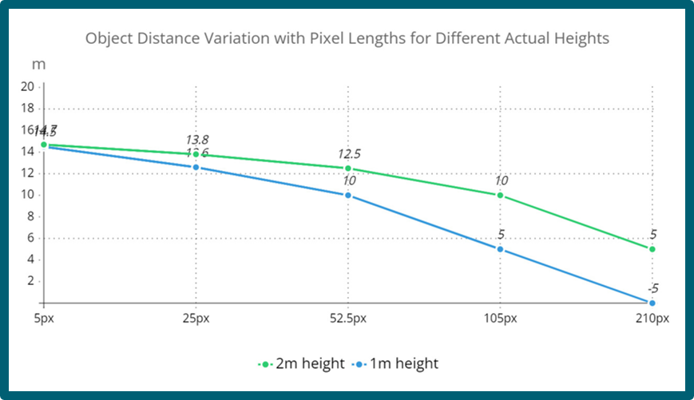

The fit is calibrated between 5 m and 10 m, so values outside that range are extrapolated. The negative value at 210 px for the 1 m object is outside the valid range, and the `max(..., 0)` in the code clips it to zero.

### 4. Odometry filtering

Raw odometry is noisy, so position and orientation each go through a Kalman filter before they reach the controller. The filter uses a 6-state constant-velocity model (time step 0.1 s, process noise 0.01) with tuned measurement noise. `Odom_Manager` then converts the filtered quaternion to a heading in degrees and counts full turns, so the heading keeps increasing past 360 degrees instead of wrapping.

### 5. Control

- **Path:** a PID controller drives the speed toward the target distance (or heading). The published speed is scaled down (0.25, and 0.22 on the lane change track).
- **Pedestrians:** a second PID uses the distance to the nearest pedestrian in the lane. The speed command shrinks as the car closes in on 6.5 m (8.5 m on the circular track) and reaches zero there, where the brake is applied. The car waits until the pedestrian has crossed, then continues.
- **Cars:** a car closer than 12 m raises the lane-change flag. The car steers left, passes, and steers back right.
- **Cones:** a cone closer than 9 m raises the collision-avoidance flag, which runs a short steering maneuver (left 5, right 80, left 5 degrees on the custom track).
- **Steering:** a PID on the heading error, limited to 30 degrees.

| Controller | Kp | Ki | Kd |
|---|---|---|---|
| Path | 0.05 | 0.000065 | 0.045 |
| Pedestrian | 0.0823 | 0.000015 | 0.45 |
| Steering | 0.0375 | 0.001 | 0.0675 |

## Tracks and results

| Track | Script | Behavior |
|---|---|---|
| Linear | `cpcDetection_LinearTrack.py` | Drives 75 m in a straight line and stops for pedestrians |
| Lane change | `cpcDetection_LaneChange.py` | Changes lane around a car closer than 12 m, then returns |
| Circular | `cpcDetection_CircularTrack.py` | Holds a constant steering angle until the heading reaches 720 degrees, avoiding cones on the way |
| Custom | `cpcDetection_CustomTrack.py` | Follows waypoints with 90 and 180 degree turns, handles cars, cones and pedestrians, then stops at the end |

All runs were logged and plotted in MATLAB: trajectory, speed, orientation, steering, pedestrian distance and raw vs filtered odometry. The runs shown here were recorded between 14 July and 11 August 2024.

### Linear track

| Track | Telemetry |
|---|---|
| 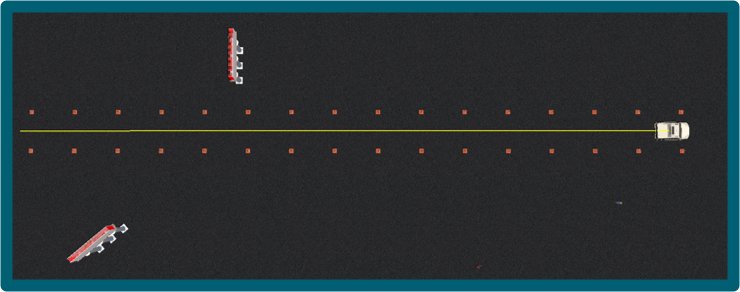 | 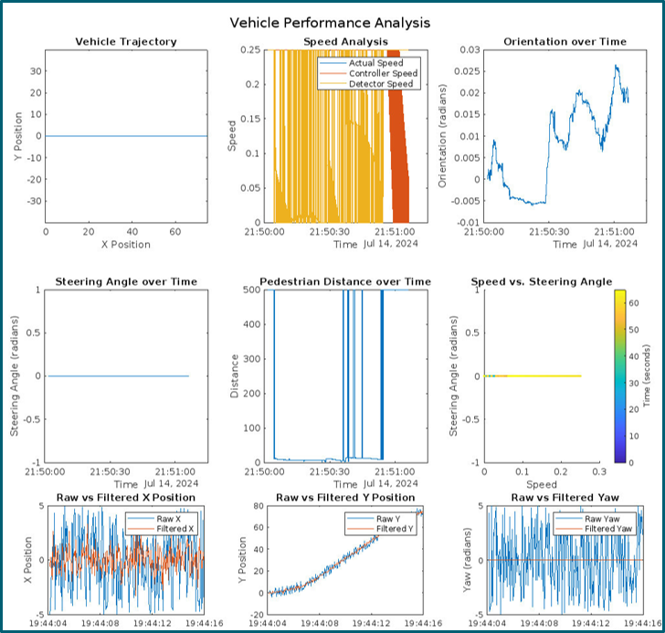 |

### Lane change track

| Track | Telemetry |
|---|---|
| 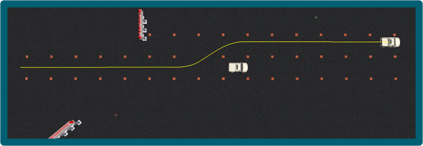 | 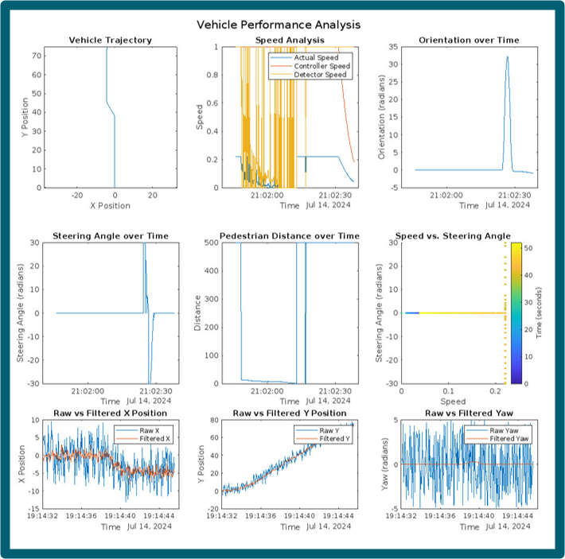 |

### Circular track

| Track | Telemetry |
|---|---|
| 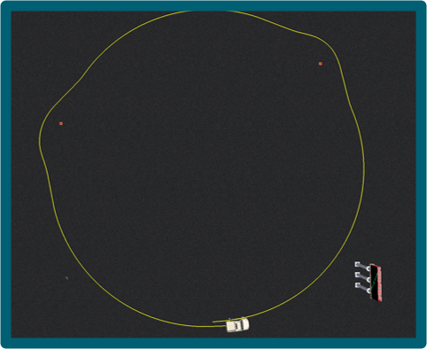 | 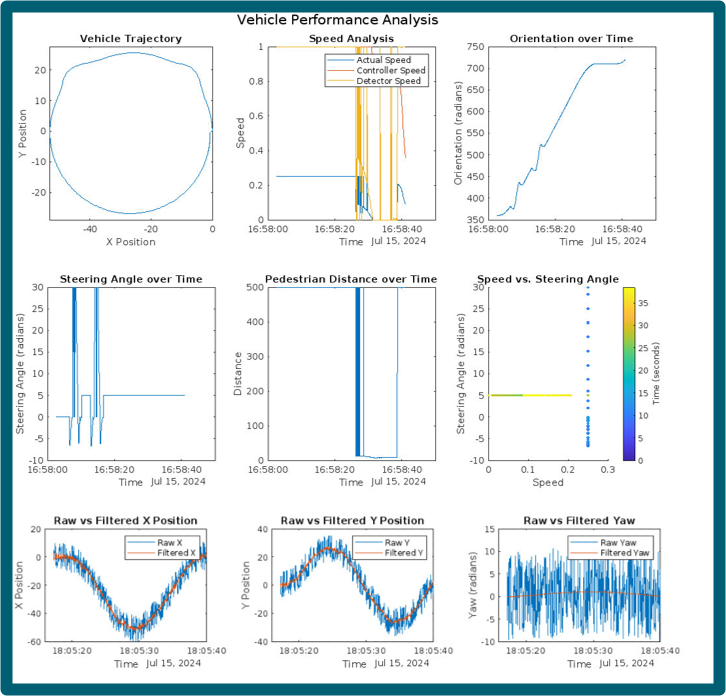 |

### Custom track

The custom track has several corners to test steering accuracy, another car to test lane changes, cones to test maneuvering, and pedestrians to test stopping.

| Track | Telemetry |
|---|---|
|  | 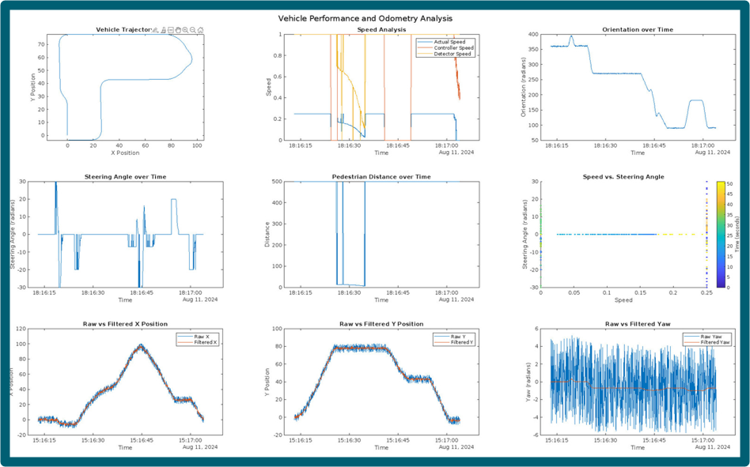 |

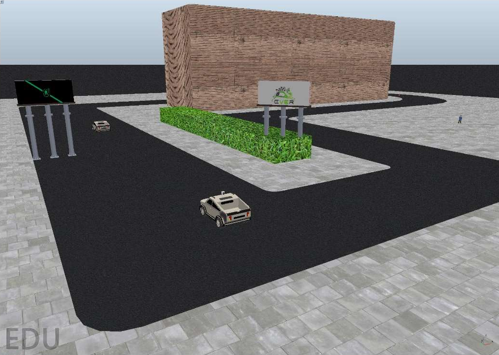

### Demo videos

| Track | Video |
|---|---|
| Linear | [Watch video](docs/Videos/linear-track.mp4) |
| Lane change | [Watch video](docs/Videos/lane-change.mp4) |
| Circular | [Watch video](docs/Videos/circular-track.mp4) |
| Custom | [Watch video](docs/Videos/custom-track.mp4) |

## Software

```
src/linear_track/            catkin package (ROS 1, Python)
  src/Milestone3/            one script per track
models/                      put the two YOLO weights here
```

Each script is a self-contained ROS node (`velocity_publisher`) with the detector, Kalman filter, PID controller, vehicle controller and odometry manager in one file.

### Requirements

- Ubuntu with ROS 1 and `catkin`
- CoppeliaSim EDU with the ROS interface and the track scenes
- Python 3 with `torch`, `ultralytics`, `opencv-python`, `numpy`, `cv_bridge` and `tf`
- The weights `CPC_model.pt` and `custom_c7_model.pt` in `models/`
- MATLAB, only for the telemetry plots

### Run

1. Put the two weight files in `models/`.
2. In each script, update the YOLO path to point to the weights. The original paths are hard-coded to the author's machine.
3. Build the workspace: `catkin_make`, then `source devel/setup.bash`.
4. Open the track scene in CoppeliaSim and start the simulation.
5. Run the script for the track, for example `rosrun linear_track cpcDetection_LaneChange.py`.

## Documentation

The full methodology, algorithm description, code listings and performance analysis are in the [Milestone 3 report](docs/report/Milestone_Three_Report.pdf).

## Repository structure

```
e-rally-autonomous-track/
├── README.md
├── LICENSE
├── .gitignore
├── models/
├── src/
│   └── linear_track/
│       ├── package.xml
│       ├── CMakeLists.txt
│       └── src/
│           └── Milestone3/
│               ├── cpcDetection_LinearTrack.py
│               ├── cpcDetection_LaneChange.py
│               ├── cpcDetection_CircularTrack.py
│               └── cpcDetection_CustomTrack.py
└── docs/
    ├── videos/
    │   ├── linear-track.mp4
    │   ├── lane-change.mp4
    │   ├── circular-track.mp4
    │   └── custom-track.mp4
    ├── report/
    │   └── Milestone_Three_Report.pdf
    └── images/
        ├── 01-system-uml.png
        ├── 02-ros1-architecture.png
        ├── 03-distance-vs-pixel-height.png
        ├── 04-distance-calibration-scene.png
        ├── 05-ever-logo.png
        ├── 06-dataset-health-check.png
        ├── 07-pedestrian-lane-roi.png
        ├── 08-straight-track.png
        ├── 09-straight-telemetry.png
        ├── 10-lane-change.png
        ├── 11-lane-change-telemetry.png
        ├── 12-circular-track.png
        ├── 13-circular-telemetry.png
        ├── 14-full-track.png
        ├── 15-full-track-telemetry.png
        └── 16-custom-track-3d.png
```

## Team and credits

Team **E-Rally**, Helwan University, autonomous track sub-team.


## License

MIT. See [LICENSE](LICENSE).